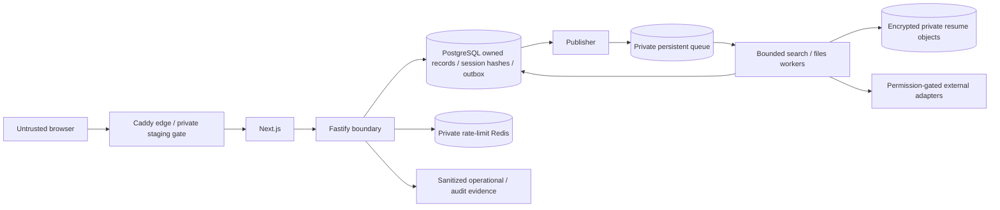

# CareerScope baseline threat model

Baseline runtime SHA: `45d6d35691bd5d41257da4f3988acd9a89c7d2ea`.
Source-first starting model for v12 security review, not certification or a
complete OWASP assessment. No dynamic attack, provider call or production access
was performed to produce this model.

## Actors and assets

Current actors: anonymous caller, candidate session owner, private test-account
selector user, worker/publisher service, host operator. Required but not yet
implemented as real authority: employer-authorized recruiter, staff admin,
super admin, support access with consent/reason and dual approval.

Protected assets: session/CSRF/provider secrets, private profile and resume data,
application/lifecycle truth, source permissions/provenance, queue/outbox integrity,
storage encryption keys, privileged audit evidence and release provenance.
Test role labels must never become real privileges without server-owned authority.

## Trust boundaries / data flow

The deployment uses a shared private network namespace and only intended edge
publication. Source configuration is not proof of live firewall/TLS isolation.
Resume/job/provider text is untrusted input, never instructions. Queue commands
should contain bounded identifiers, not private source text. Existing session
hashes/CSRF protect current ownership; target OTP/refresh/device/recovery authority
must be designed and tested before public production sign-in is possible.

## Abuse cases and review requirements

| ID    | Abuse / failure                                             | Current observation                                                                                                                                                                                            | Required proof / remediation                                                                                                                                                                                                    |
| ----- | ----------------------------------------------------------- | -------------------------------------------------------------------------------------------------------------------------------------------------------------------------------------------------------------- | ------------------------------------------------------------------------------------------------------------------------------------------------------------------------------------------------------------------------------- |
| TM-01 | Production persona selection bypasses identity proof        | Explicit proxy test mode accepts production NODE_ENV                                                                                                                                                           | Fail-closed deployment-environment guard and startup-negative matrix; no live exposure inferred                                                                                                                                 |
| TM-02 | Cross-owner/API/cache/file/export access                    | Session-derived owner and existing tests observed                                                                                                                                                              | Denial for every new v12 actor/resource/query/job; cache switch/logout leakage tests                                                                                                                                            |
| TM-03 | OTP guessing/enumeration/replay/provider outage             | Existing-account OTP uses persisted one-use HMAC challenges, expiry/attempt caps, shared Redis email/IP limits and fail-closed provider errors; only Resend is selected and live delivery is unverified        | Preserve challenge/rate-limit invariants; select and independently validate an approved fallback provider before claiming outage resilience; verify real sender settings and staged delivery without logging codes or addresses |
| TM-04 | Refresh theft/reuse and privileged role escalation          | Opaque refresh families rotate transactionally; consumed-token reuse revokes the family; owner-scoped device-session listing/revocation is implemented and locally tested. Production staff MFA/RBAC is absent | Keep rotation/reuse and ownership regression tests; define production staff identity/role and step-up policy, implement MFA with deny-by-default authorization, and require independent review before production enablement     |
| TM-05 | SSRF/source-rights bypass or untrusted posting instruction  | D14 candidate-source and per-capability permission gates now fail closed; no live source profile is approved. Public indexing remains absent.                                                                  | Preserve request/destination controls; obtain and review real per-source rights before enabling collection/storage/display; keep untrusted posting text inert and prove SSRF/redirect controls                                  |
| TM-06 | Malicious resume/path traversal/full-disk/parser exhaustion | Private encrypted file subsystem and bounded parser exist                                                                                                                                                      | Verify OS sandbox, symlink/ownership/content/size/cancellation/capacity/crash/delete behavior; not just happy-path upload                                                                                                       |
| TM-07 | Duplicate/stale asynchronous effects                        | Existing outbox/fencing/private queue                                                                                                                                                                          | Real DB/queue crash, replay, expired lease, cancellation, DLQ/reconciliation and graceful drain tests                                                                                                                           |
| TM-08 | PII/credential leakage in logs/storage/bundles/screenshots  | Scanner and structured logs exist, CR-01 broader checks missing                                                                                                                                                | Synthetic secret fixtures across errors/headers/storage/cache/bundles/telemetry/redacted exports; narrowly reviewed expected-runtime allowlist                                                                                  |
| TM-09 | Recruiter/admin/support misuse                              | No complete control plane                                                                                                                                                                                      | Employer authorization, masked fields, time-limited reasoned access, immutable/tamper-evident manual+automated audit and dual approval                                                                                          |
| TM-10 | Outreach abuse/false delivery state                         | Domain absent/conditional                                                                                                                                                                                      | Verified recipient/selected scanned document, disclosure/reply-to/caps/suppression, no unreceived read/reply claims                                                                                                             |
| TM-11 | Backup loss/restored deleted records                        | Local verification source exists                                                                                                                                                                               | Independent encrypted off-host/WAL evidence, deletion reapplication and timed disposable restore; D12 decision                                                                                                                  |
| TM-12 | Untrusted CI code/secrets or unsafe promotion               | Workflows absent; main not protected per read-only query                                                                                                                                                       | Owner protections/settings, no production secrets, pinned least-privilege actions, exact artifact/SHA and negative-control gates                                                                                                |
| TM-13 | Dependency-driven code/availability compromise              | Current audit has development high and parser moderate entries                                                                                                                                                 | Actual path/reachability/compatible remediation, lockfile review, current scans; no generic waiver                                                                                                                              |
| TM-14 | Conditional AI injection/data exfiltration/tool abuse       | AI provider removed; optional activation not approved by implementation alone                                                                                                                                  | Keep disabled; if implemented, untrusted-data separation, tool auth/output validation, minimization/no-training evidence, quotas and injection tests                                                                            |

## Constraints and residual risk

No real customer data in tests/reviewer context. No live credential rotation,
settings, deployment, terms acceptance or real communications by an agent.
No raw database editor or secret viewer as an admin shortcut. Existing static
scans do not prove complete history secrecy or compliance. Provider/legal/device/
field/production acceptance stays separate; risk exceptions require the strict
owner process and cannot excuse an exploitable critical or legal violation.

Every confirmed finding must gain severity, reachable path, affected data,
reproduction, remediation, regression tests and independent retest evidence.
The table is a threat inventory, not a claim that every threat is exploitable.
